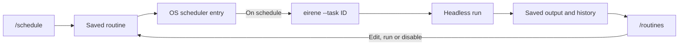

# Routines

[Documentation](../README.md) / Automation / Routines

A routine runs a saved prompt on a schedule, using your operating system's scheduler. Eirene does not need to be open. You choose the workspace, model, access, tools, MCP servers and skills in advance, and each run is recorded for you to review.



## Create a routine

```text
/schedule Summarize changes in this repository since the previous workday.
```

`/schedule` asks about each decision in turn. Choose work that can finish without asking you anything. Prompts can be up to 4,000 characters.

| Step | Choices |
| --- | --- |
| What to do | The prompt. |
| Name | A short name, shown in `/routines`. |
| Work directory | This project, or another folder. |
| Workspace | Only inside a Git repository: an [isolated Git copy](#isolated-git-copies) or directly in the folder. |
| Model | The model you are using now, whatever is active when it runs, or another saved provider and model. |
| Access level | **Sandboxed** (workspace only, commands without network) or **full access** (host files, network and commands without isolation). |
| Allowed tools | Read only, read and edit, edit and run commands, read and web, everything, or a custom list. |
| MCP servers | Only if a server is enabled in `/mcp`: none, all enabled, one, or several by name. |
| Skills | Only if skills are installed: those enabled in `/skills` at run time, none, all installed, one, or several by name. |
| Frequency | See [Schedule formats](#schedule-formats). |
| Signed out | Windows only: run only while signed in, or also while signed out. See [Windows](#windows). |

A summary appears before the final confirmation, and nothing is installed until you confirm.

## Schedule formats

| Input | Meaning |
| --- | --- |
| `every 30m` | Every 30 minutes. |
| `every 2h` | Every two hours. |
| `hourly` | On the hour. |
| `daily at 09:00` | Each day at this local time, in 24-hour notation. |
| `mon at 18:30` | Weekly on this day. |
| `at startup` | At your next login or startup, as your scheduler defines it. |

Intervals can be from one minute to 30 days. An interval routine first runs one interval after it is installed or re-enabled, not immediately. On Linux, the interval also restarts after each boot or login.

## Tool groups

Tools are granted in groups. Reading is always allowed. Tools outside the granted groups are not offered to the model, and any call to one is blocked.

| Group | Grants |
| --- | --- |
| `read` | Reading, listing and searching files; plans, skills and process output. |
| `edit` | Creating and changing files. |
| `commands` | Shell commands and managed processes. |
| `web` | Web search, fetch, HTTP requests and the browser. Granting it approves network access for those tools. |
| `mcp` | Tools from the MCP servers chosen for the routine. Set by the MCP step. |
| `agents` | Delegating work to [subagents](../guides/subagents.md), which inherit the same limits. |

Type a custom list as names separated by commas or spaces, such as `edit, commands`. `all` grants every group.

## MCP servers and skills

Nobody is around to approve an MCP tool call during a run, so choosing a server for a routine is the approval. Only those servers start, and only while they are still enabled in `/mcp`. A server that has been disabled or needs a new sign-in (`/mcp login NAME`) is reported in the run's output, and its tools are missing.

Skills chosen for a routine are offered even if they are off in `/skills`. A skill that has since been removed is reported and skipped.

## Isolated Git copies

With an isolated copy, each run gets its own clone of the last commit, under `task-worktrees/TASK_ID/RUN_ID` in the [data directory](../reference/data-directory.md), on a branch named `eirene/RUN_ID`. Your working tree is never touched and the clone has no remote, so nothing in the run can reach your real repository. Uncommitted local changes are
not included.

The whole history is copied, which takes time and space on a very large repository. In that case, consider running directly in the folder.

A run that changes nothing has its copy removed. A run that leaves edits or commits keeps it, and `/routines` shows the path. To bring commits back, run this in your repository, then merge or cherry-pick:

```sh
git fetch PATH eirene/RUN_ID
```

Kept copies are never deleted automatically. **Kept git copies** in `/routines` lists them with their size and discards them when you are done, and removing a routine deletes them too.

## Review and manage routines

```text
/routines
```

The overview lists each routine with its schedule, scheduler state, access, folder, prompt and last result. Open a routine to:

- read the **latest output**: the final answer, status, duration, attempts, token use, session ID, errors and any kept Git copy;
- browse the **run history**, with the output of the last 50 runs;
- view its **settings**;
- **edit** its prompt, model, access level, tools, MCP servers or skills. Changes apply from the next run, and a change to full access asks for confirmation. To change the schedule, folder or workspace, remove the routine and create it again;
- **run it now** through the OS scheduler, so that it runs exactly as a scheduled run would and continues after you close Eirene;
- **enable or disable** it, which pauses or resumes the OS scheduler entry;
- review or discard its **kept Git copies**;
- **remove** it, with its history and kept copies.

To start a routine from a shell, using its recorded settings:

```sh
eirene --task TASK_ID
```

## What runs can and cannot do

Runs use headless [Auto mode](headless.md#modes-and-approvals) within the access and tools you chose, and cannot answer questions. A sandboxed run that tries to leave the workspace is blocked.

Runs can fail if credentials, dependencies or the project folder are missing. Keep the directory available, and make sure the scheduler's environment can find Eirene and your tools.

A disabled routine started with `--task`, or a run skipped because the previous one is still going, can exit successfully without doing the work. Check the history to tell these apart.

Retries can repeat actions from a partly completed run, so use them only for work whose effects you understand.

## Operating system details

| System | Scheduler |
| --- | --- |
| Linux | User systemd services and timers. |
| macOS | launchd. |
| Windows | Task Scheduler, through `schtasks`. |

Whether a run happens while you are logged out, and how missed runs catch up, depends on the scheduler. On Linux, user timers need a user service manager, and Eirene warns you during creation if runs might not happen while you are logged out.

### Windows

By default, a routine runs only while you are signed in. Choosing **also while signed out** works in one of two ways, picked automatically:

| Eirene is running | Registered with | What you do |
| --- | --- | --- |
| As administrator | S4U logon, with no password stored | Nothing extra. |
| Normally | Your Windows password | Type it once. Eirene hands it to Windows over a pipe, never on a command line, and does not save it. Windows keeps it in its own credential store. |

Before installing with a password, Eirene tests it with a throwaway task, because Windows accepts a password for an account lacking the "log on as a batch job" right and then never starts the task. If the test fails, because of a wrong password, a missing right, or a passwordless Windows Hello account, the routine is created to run only while signed in and
the reason is shown. Standard accounts usually lack that right, but an administrator can grant it.

**If you change your Windows password,** a password-registered routine stops working, and Windows records this only in an event log that is off by default. `/routines` shows a red note if the latest scheduled run did not start (allowing ten minutes), or if your password changed after the routine was created with no run since. A missed run can also just mean the PC was off.
After a password change, remove the routine and create it again.

Routines running signed out have these limits:

- S4U routines cannot read Windows Credential Manager, so use the file [credential store](../reference/configuration.md#credentials) for their provider key.
- Neither kind can reach network shares that need your interactive sign-in.

Task Scheduler repeats either under 24 hours or in whole days, so `every 48h` works, while `every 25h` is refused before anything is installed.

## Advanced settings

Routines are stored in `tasks.json` in the [data directory](../reference/data-directory.md). These run settings have no menu. Close Eirene before editing the file, and keep each routine's ID and schedule structure.

| Field | Default | Meaning |
| --- | --- | --- |
| `enabled` | `true` | Whether invocations do any work. |
| `timeout` | `3600` | Seconds per attempt, from 60 to 86,400. |
| `retries` | `0` | Extra attempts after a failure, from 0 to 10. |
| `retry_delay` | `30` | Seconds between attempts, from 1 to 3,600. A value of 0 is replaced by 30. |
| `allow_overlap` | `false` | Whether a run may start while another is active. |
| `env` | `{}` | Extra environment values. These are stored on disk, so avoid putting keys here. `EIRENE_HOME`, `PYTHONPATH`, `PYTHONHOME` and `LD_PRELOAD` cannot be set. |
| `timezone` | `local` | Calendar time zone. Honored only on Linux, and changing it needs a reinstall. |
| `access` | `sandboxed` | `sandboxed` or `full-access`. |
| `tools` | every group | Granted [tool groups](#tool-groups). |
| `mcp_servers` | `[]` | Servers the run may call. `["*"]` means every server enabled in `/mcp`. Needs `mcp` in `tools`. |
| `skills` | `null` | `null` follows `/skills`, `[]` allows none, `["*"]` allows all installed. |
| `workspace` | `project` | `project` (in place) or `worktree` (isolated Git copy). |
| `run_signed_out` | `false` | Windows only. Changing it needs a reinstall. |
| `signed_out_logon` | `""` | `s4u` or `password`. The password itself is never in this file. |

One invocation can take up to `(retries + 1) × timeout + retries × retry_delay` seconds. The overlap lock and the Linux service timeout allow that plus five minutes.

Adding an entry to `tasks.json` does not install it in the OS scheduler, so always create routines with `/schedule`. See [Data directory](../reference/data-directory.md#move-to-another-computer) before moving an installation that has routines.
