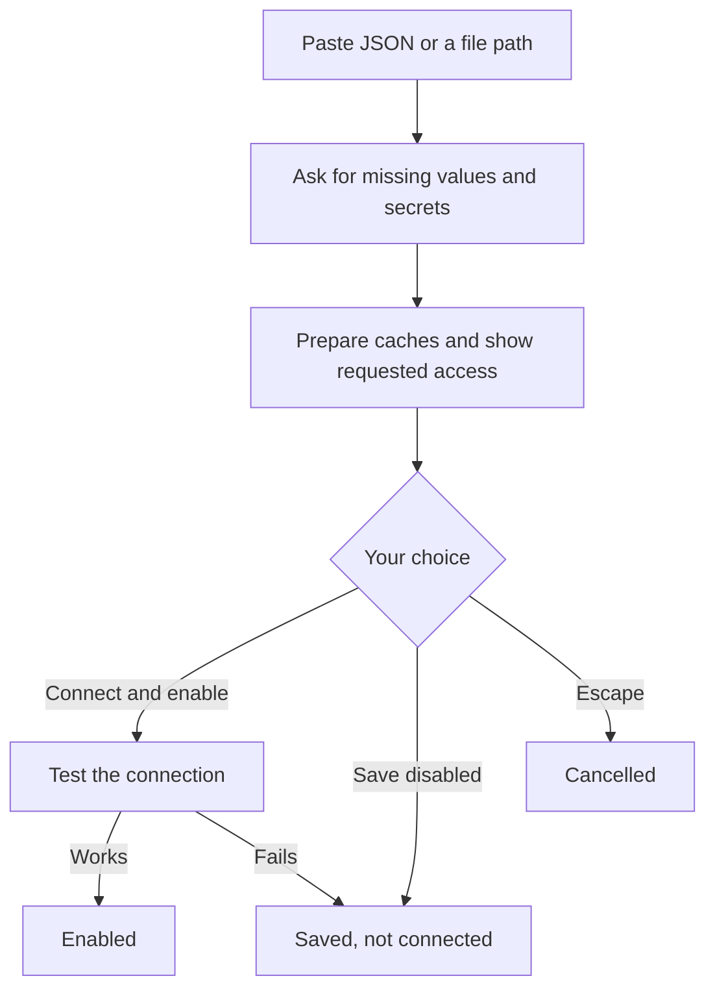

# MCP servers

[Documentation](../README.md) / Extending Eirene / MCP servers

The [Model Context Protocol](https://modelcontextprotocol.io) lets a model use tools from another program or service, such as GitHub, a database or a browser. Eirene connects to servers over stdio, Streamable HTTP (`type: "http"`) and the older SSE
(`type: "sse"`). MCP servers can come from a [plugin](plugins.md) or be added directly.

## Add a server

```text
/mcp add
```

Paste the MCP JSON from the server's documentation, or enter the path to a JSON file. Eirene resolves missing values, prepares what the server needs to run, detects authentication, and tests the connection before enabling it.



**Connect and enable** authorizes launching that local command, and package launchers such as `npx` may download packages. Node.js or `uv` must already be installed for those commands. Eirene does not install system runtimes.

The [MCP examples](../mcp-examples/README.md) include ready-to-import JSON for 24 services such as GitHub, Cloudflare, Notion, Slack and PostgreSQL.

### Accepted formats

Eirene accepts `mcpServers`, `mcp_servers`, VS Code's `servers` and `inputs`, `mcp.servers`, OpenCode's `mcp`, and a bare map of servers. Markdown code fences, comments and trailing commas are tolerated. Use `/mcp add NAME` for a single unnamed server object. Simple
`npx mcp-remote URL` declarations are converted to a direct HTTP or SSE connection.

These placeholders are resolved: `${VAR}`, `${env:VAR}`, `${VAR:-default}`, `${input:id}`, `${workspaceFolder}` and `${userHome}`. Missing secrets and documentation placeholders are requested securely. VS Code's `promptString` and `pickString` inputs work, but editor-specific
command inputs are rejected and never run as shell code.

### Other commands

```text
/mcp add my-server https://example.com/mcp
/mcp import
/mcp import /path/to/mcp.json
/mcp test my-server
/mcp login my-server
/mcp remove my-server
```

`/mcp import` reviews connections before saving and asks before replacing a name. `/mcp test` connects and lists tools, without calling them, so it does not prove that write permissions or deployments work. Removing a remote server also removes its saved credentials.

## Sign in to a remote server

Remote servers can use browser OAuth, a bearer token, custom headers, or no authentication. If you supply no headers, Eirene discovers OAuth automatically.

```text
/mcp login my-server
```

Tokens and header credentials are stored privately under `mcp-auth/` in the [data directory](../reference/data-directory.md), separate from `config.json`. Background connections never open a browser, so if a server needs a new sign-in, it fails to connect until you run this command.
Adding write permissions later may need another sign-in with those scopes.

For servers that need a pre-registered OAuth client, add an `oauth` object with `client_id`, `client_secret`, `redirect_uri` and `authorization_params`. For example, Google's `access_type=offline` and `prompt=consent` go in `authorization_params`. Redirect URIs must be HTTP localhost addresses
with a port. App registration, tenant consent and account plans must be arranged with the service.

## Turn servers on and off

```text
/mcp
```

Select a server to toggle it, then press Escape. The footer shows the access it requests. Finish or stop the current turn first.

| Server added by | How it turns on |
| --- | --- |
| You, through `/mcp add` or `config.json` | When you enable it in `/mcp`. |
| A plugin | When you [trust the plugin](plugins.md#trust-a-plugin). `/mcp` can then turn it off. |

Servers start on your next normal turn. In Plan mode they do not start at all. Turning a server off stops its process.

## Use the tools

Ask in ordinary language, or use a plugin's command:

```text
/playwright Check the local app's navigation and report broken links.
```

Eirene discovers whatever tools the running server offers. On API connections, tools are exposed as `mcp__SERVER__TOOL`, and the model must support tool calling. Codex and Claude Code receive local server declarations directly. Remote servers reach them through a bundled proxy, which shares Eirene's
saved login without exporting tokens.

A server that starts may still need more setup: a browser binary, a language toolchain, a project selection or an authorized account.

Tools appearing does not mean they will work. A [headless run](../automation/headless.md#mcp-servers-and-skills) starts servers only if you grant them with `--mcp`.

## Add a server by hand

`/mcp add` is usually easier, but you can also close Eirene and merge a declaration into `mcp_servers` in [`config.json`](../reference/configuration.md#mcp-servers):

```json
{
  "mcp_servers": {
    "local-tools": {
      "command": ["/absolute/path/to/server", "--stdio"],
      "env": {"SERVER_SETTING": "value"},
      "network": false,
      "startup_timeout": 60,
      "request_timeout": 30
    }
  }
}
```

Then start Eirene, open `/mcp` and enable `local-tools`. Commands are not run through a shell, so pipes, shell variables and a single command-plus-arguments string do not work. Use the array form or separate `command` and `args` fields. All fields are listed in
[MCP server fields](../reference/configuration.md#mcp-server-fields).

## What a server can access

Stdio servers run in the [sandbox](../guides/modes-and-permissions.md#the-sandbox) with only the access they declare:

- **Working directory:** the workspace, unless `cwd` names a folder inside it.
- **Network:** only with the JSON value `network: true`. Remote servers have it by default.
- **Extra paths:** `read_paths` and `write_paths`. These paths must already exist, and `/` cannot be granted.
- **Environment:** a filtered set plus `env`. The home folder is private.

Isolation covers the server's process. It does not limit what the remote service allows or what a tool does there, so set up restricted accounts on the service itself.

### Automatic read access

For local servers added through `/mcp`, Eirene grants the read access a launcher needs each time it starts, separately from your `read_paths`:

- A script argument (`.py`, `.js`, `.ts`, `.jar` and similar) gets its project root: the nearest folder with a marker such as `pyproject.toml`, `package.json` or `.git`, widened to the enclosing Git repository. Without a marker, it gets the script's own folder.
- Folder arguments such as `uv run --directory /path`, `PYTHONPATH` and `NODE_PATH` entries, and a project virtual environment's project are also granted.

Eirene never grants these automatically: a filesystem or drive root; shared folders such as `/home`, `/opt` or `C:\Program Files`; your home folder or anything above it; the system temp folder; credential stores such as `~/.ssh`, `~/.aws` or `~/.kube`; or its own data, other than plugin and MCP runtime
folders. A grant narrows to the script's folder, then the single file, instead of widening. A file withheld this way is listed during setup, and you can add it to `read_paths` deliberately.

### On Codex and Claude Code

These connections receive `command`, `args`, `env` and `cwd`. They run the server under their own sandbox, so Eirene's `network`, `read_paths`, `write_paths` and timeouts do not apply.

## Troubleshoot a server

```text
/mcp test NAME
/plugins doctor NAME
```

Check `PATH`, whether the server is enabled, your current mode, whether your provider supports tools, and network access for first-use downloads. `/plugins doctor` works for a plugin's servers. Error messages include the end of the server's stderr when available.

| Symptom | Likely cause |
| --- | --- |
| Timeout during startup | A first-use download, or a wrong executable. Raise `startup_timeout` only in the first case. |
| Invalid JSON | The server is printing logs to stdout. Logs must go to stderr. |
| Missing file or module | The runtime is outside the sandbox's view. Add its folder to `read_paths`. |
| Empty tool list | The server found nothing to offer. Check its own configuration. |

Limits worth knowing:

- Stdio messages are newline-delimited JSON of up to 4 MiB per line.
- Timeouts are 1 to 600 seconds. Other values fall back to 30.
- Eirene is a tool client. It does not offer resource browsing, prompt pickers, sampling or elicitation.
- Non-text content in a tool result is passed along as JSON text, so images may not be displayed as images.
