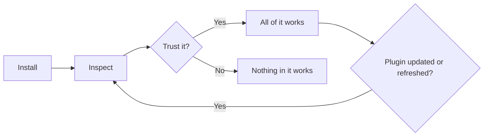
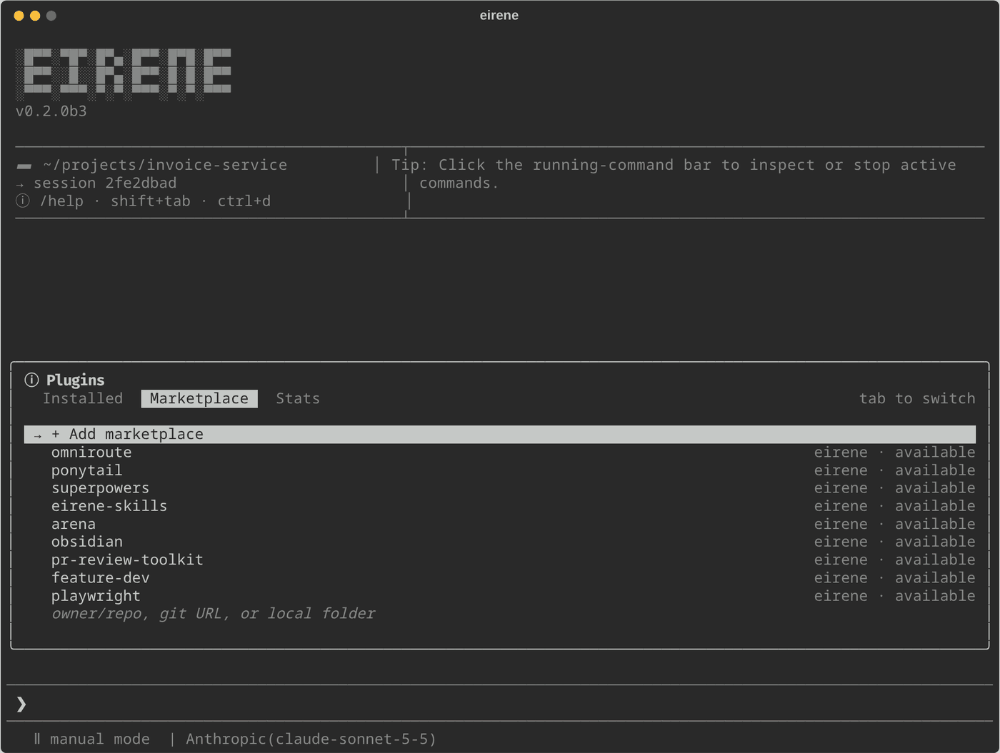

# Plugins

[Documentation](../README.md) / Extending Eirene / Plugins

A plugin is a bundle that can contain [skills](skills.md), slash commands, [specialist profiles](../guides/subagents.md#specialist-profiles), hooks and [MCP servers](mcp.md). Hooks and MCP servers
run programs on your machine, so nothing in a plugin works until you explicitly trust it.



## The plugins menu

```text
/plugins
```

`/plugin` is an alias. The menu has three tabs. Tab and Shift+Tab (or Left and Right) switch between them, Up and Down move in the list, typing filters it, and Escape closes it. Changes are blocked
while Eirene is working.



| Tab | Shows |
| --- | --- |
| **Installed** | Your plugins. Enter opens trust, enable or disable, inspection, diagnostics, update and uninstall. |
| **Marketplace** | [Marketplaces](#marketplaces) you added and their plugins, followed by the [catalog](plugin-catalog.md). Enter installs a plugin. Entering a marketplace shows only its plugins, with update and remove actions. |
| **Stats** | For each plugin, its skills, commands, hooks, MCP servers, approximate token size and state. This describes what is installed, not how often it is used. |

## Install a plugin

```text
/plugins browse
/plugins install superpowers
/plugins inspect superpowers
```

`/plugins install` accepts any of these sources:

```text
/plugins install NAME
/plugins install NAME@MARKETPLACE
/plugins install owner/repository
/plugins install owner/repository/path/to/plugin
/plugins install https://github.com/owner/repository/tree/main/path/to/plugin
/plugins install /absolute/path/to/local-plugin
```

- GitHub sources need Git on `PATH` and network access. Private repositories need Git authentication that already works, since Eirene does not prompt for credentials.
- A GitHub tree URL must include a branch or tag and a plugin directory. Branch names containing slashes are not supported in this form.
- Eirene downloads and imports the files, but never runs a repository's install script. It keeps supporting files and licenses, and rejects bundles containing symlinks.
- If the plugin is already installed, its files stay as they are. Use [`/plugins update`](#update-a-plugin) instead.

## Trust a plugin

```text
/plugins trust NAME
```

Eirene shows what the plugin contains and asks once. After that, all of it works: commands and skills straight away, hooks and MCP servers from your next message. There is no separate step in `/mcp`.
Until then, typing one of its commands tells you to trust it. This applies however the plugin arrived, including files copied by hand.

Trust does not grant extra access. Plugin tools still follow your [mode and sandbox](../guides/modes-and-permissions.md).

Plan mode does not run hooks or start MCP servers, even for trusted plugins.

Trust is removed when:

- you run `/plugins untrust NAME`;
- you run `/plugins refresh NAME`;
- `/plugins update` finds that the plugin changed, since you trusted the earlier code.

## Turn parts off

| To turn off | Use |
| --- | --- |
| A whole trusted plugin, for now | `/plugins disable NAME` (and `/plugins enable NAME`) |
| All of a plugin, withdrawing trust | `/plugins untrust NAME` |
| One skill | `/skills` |
| One MCP server | `/mcp` |

Trusting a plugin again turns its servers back on.

## Use plugin commands

```text
/feature-dev Add a CSV export for filtered invoices.
/pr-review-toolkit:review-pr tests errors
```

A plugin command adds written instructions to a normal agent turn. It follows your current permissions and does not run every workflow in the plugin.

A command appears as `/command`. If another plugin or a built-in command has the same name, it appears as `/plugin:command` instead. The long form always works when typed, so use it in saved instructions.
`/help` and the `/` menu show what is available.

## Check for problems

```text
/plugins doctor
/plugins doctor playwright
```

The doctor checks activation, required programs, provider limitations and known startup errors, without running plugin code. It cannot tell whether a browser, remote account or language server actually works.

## Update a plugin

```text
/plugins update NAME
/plugins update
```

Update downloads a plugin again from where it was installed: its marketplace (refreshed first), catalog shortcut, GitHub source or local folder. Without a name, it updates all plugins and reports failures
one by one. If an update fails, the installed version stays in place.

Plugins that ship with Eirene (`eirene-skills`, `superpowers`, `arena` and `obsidian`) update from [`eirene/plugins`](https://github.com/0v3rf3ar/Eirene/tree/master/eirene/plugins) on the `master` branch. This needs
Git and network access, unlike installing them, and can be newer than your version of Eirene.

If nothing changed, nothing happens. If anything changed, the plugin's trust is removed, so inspect it and trust it again. Your enable and disable choices are kept. `skills/NAME/` is replaced, and if it might hold
your edits, a copy is saved first under `plugin-data/NAME/skills-backup-TIMESTAMP/`.

A plugin installed before updates were tracked, with no catalog shortcut, must be uninstalled and installed again once.

### Refresh

```text
/plugins refresh NAME
```

Refresh rereads the files already installed and rebuilds Eirene's index of them, without downloading anything. Use it after you edit an installed plugin by hand. It removes trust, so trust the plugin again afterwards.

## Uninstall a plugin

```text
/plugins uninstall NAME
```

After confirmation, this deletes the plugin, its `skills/NAME/` copy, and its trust and enable settings.

## Marketplaces

A marketplace is a repository or folder with a `marketplace.json` listing plugins, in the format Claude Code publishes.

```text
/plugins marketplace add kepano/obsidian-skills
/plugins install obsidian@obsidian-skills
```

| Command | Action |
| --- | --- |
| `/plugins marketplace add SOURCE` | Add `owner/repo`, an `https://` or `git@` Git address (optionally ending in `#ref`), or a local folder. |
| `/plugins marketplace list` | List added marketplaces. |
| `/plugins marketplace update [NAME]` | Download the catalogs again. Installed plugins do not change. |
| `/plugins marketplace remove NAME` | Forget a catalog. Plugins installed from it stay installed. |

Adding a marketplace saves its catalog under `marketplaces/`. Nothing in it runs, and no plugin is installed. `NAME@MARKETPLACE` also works wherever a command takes an installed plugin's name, and `NAME` alone works when
only one marketplace lists it.

Plugin sources may be relative folders or `github`, `url` and `git-subdir` Git sources, and a `sha` pin is honored. Other sources, such as `npm`, are reported as unsupported, as is a direct URL to a `marketplace.json` file. The `--scope` option is not supported,
because Eirene plugins are always installed for your user.

## What works with which provider

Written guidance is adapted to your selected provider. On API connections, specialist passes use your selected model, even if a plugin's text names another. Codex and Claude Code receive guidance and enabled stdio MCP
servers through their own interfaces. A text-only provider cannot run tools, and vision needs a suitable model.

Dependencies such as Node.js, Git, browsers and language servers must be installed separately.

| Plugin content | Support in Eirene |
| --- | --- |
| Markdown skills and commands | Supported, with their supporting files. |
| Specialist profiles | Commands, plus [subagents](../guides/subagents.md) where available. |
| `SessionStart` and `UserPromptSubmit` command hooks | Run after trust, under your execution policy. |
| Stdio MCP servers | Supported on API and CLI connections. |
| HTTP and SSE MCP servers | Supported. Use `/mcp login NAME` for authentication. |
| Status lines, LSP declarations, output styles, other hook events | Not supported. `/plugins inspect` reports them. |

To write your own, see [Writing plugins](writing-plugins.md).
