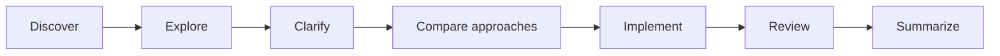

# Feature Dev

[Documentation](../../README.md) / [Plugin catalog](../plugin-catalog.md) / Feature Dev

Feature Dev guides a feature through discovery, codebase exploration, clarification, architecture, implementation and review. It is useful when a change needs a clear understanding of existing behavior before any editing.

## Install and start

```text
/plugins install feature-dev
/plugins trust feature-dev
/feature-dev Add CSV export to the invoice list, preserving the active filters and current authorization rules.
```

The full command name is `/feature-dev:feature-dev`. You need Git and your project's own build and test tools. There are no hooks or MCP servers.

## The workflow



It first establishes the goal and maps similar code, then asks about anything underspecified, compares approaches, and waits for your decisions before implementing. Include firm constraints and verification requirements in your first request to reduce avoidable questions.

Implementation follows the agreed approach, with a progress plan. Review passes check the result before the final report, which lists the files changed and checks performed. Inspect the actual diff as well.

## Specialist profiles

| Profile | Purpose | Command |
| --- | --- | --- |
| `code-explorer` | Trace existing behavior and identify important files. | `/feature-dev:agent-code-explorer` |
| `code-architect` | Propose approaches and integration boundaries. | `/feature-dev:agent-code-architect` |
| `code-reviewer` | Review correctness, conventions and maintainability. | `/feature-dev:agent-code-reviewer` |

```text
/feature-dev:agent-code-explorer Trace how filters reach the invoice query and return the key paths. Do not edit.
```

A profile command runs in the main conversation. Independent passes use [subagents](../../guides/subagents.md), which use additional tokens. On API connections, they use your selected model, whatever model the original text names.

## Plan before editing

For first exploration, start in [Plan mode](../../guides/modes-and-permissions.md#modes) and ask for analysis only. Plan mode cannot implement anything, and reaching the workflow's implementation stage does not raise your permissions. After agreeing on a design, switch to Manual or Auto, then ask to continue.

Progress can be kept in Eirene's [session plan](../../guides/plans.md). For a skill-by-skill alternative, see [Superpowers](superpowers.md).

## Origin

Made by Anthropic, with thanks. Source: [Anthropic official plugins](https://github.com/anthropics/claude-plugins-official/tree/main/plugins/feature-dev).
