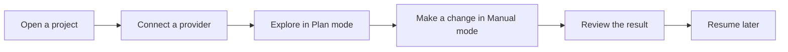
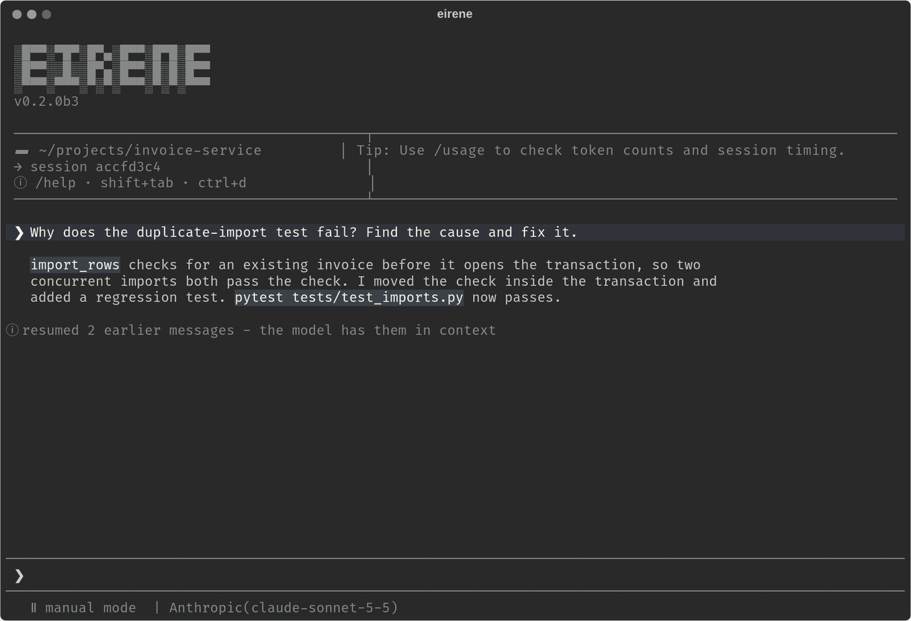

# Your first session

[Documentation](../README.md) / Getting started / Your first session

This walkthrough takes you from an empty terminal to a reviewed change. It assumes
you have [installed Eirene](installation.md) and have a project under version control
to try it on.



## 1. Open a project

Start Eirene in the directory you want it to work on:

```sh
cd /path/to/project
eirene
```

You can also start it from anywhere with `eirene -C /path/to/project`. This directory
is your **workspace**: Eirene's file access, commands, saved sessions and project
instructions are all tied to it.

The first time you open a workspace, Eirene shows its full path and asks whether you
trust its files. Project instruction files in the workspace become guidance for the
model, so only trust folders whose contents you are willing to have it follow. Your
answer is remembered for that exact path. Trusting a workspace does not grant extra
access or skip any approval.



## 2. Connect a provider

Eirene needs a model to talk to. Type this into the prompt and press Enter:

```text
/connect
```

Choose a provider, complete its sign-in or API key prompt, and pick a model. Keys go
into a hidden field, never into the chat. Eirene remembers the connection for later
sessions.

If you are not sure which to choose, [Providers and models](../providers/README.md)
compares the options.

## 3. Explore in Plan mode

Plan mode lets Eirene read your project but not change it, which makes it a safe
place to start. Press Shift+Tab until the line under the prompt says `plan mode`, or
type:

```text
/agents plan
```

Then ask a question:

```text
Explain this project's main components and how to run its tests.
```

## 4. Make a change in Manual mode

Switch to Manual mode, the default for new installations, and ask for something small.
Say what should stay the same and how to check the result:

```text
/agents manual
Fix the empty-state message on the settings page. Keep the layout unchanged and run the relevant tests.
```

In Manual mode, Eirene stops and asks before each file change and each command that is
not a plain read. Read the request before approving it, because the prompt also shows
how much access it would grant. When you are comfortable, the other modes reduce the
number of questions: see [Modes and permissions](../guides/modes-and-permissions.md).

To stop Eirene at any point, press Escape. Stopping does not roll back changes it has
already made, which is one reason to work in a Git repository.

## 5. Review the result

Eirene reports what it did and which checks it ran. Select a command's output to
expand it, and use `/diff` to open a panel of your uncommitted changes. For a second
opinion, run a read-only review:

```text
/review
```

The review lists concrete problems and changes nothing. If you want one fixed, ask for
it in your next message. See [Code review](../guides/code-review.md).

## 6. Come back later

Leave with `/exit` or Ctrl+D. Your conversation is saved, and you can pick it up again
from the same directory:

```sh
eirene --continue   # the most recent session in this workspace
eirene --resume     # choose from a list
```

Resuming restores the conversation, not your files. Eirene works with whatever is on
disk at that moment. See [Sessions](../guides/sessions.md).

## Where to go next

- [Terminal interface](../guides/terminal-interface.md) covers the composer, keyboard
  shortcuts, copying and attachments.
- [Project instructions](../guides/project-instructions.md) give Eirene your project's
  conventions and test commands on every request.
- [Skills](../extending/skills.md) and the
  [plugin catalog](../extending/plugin-catalog.md) add reusable workflows.
