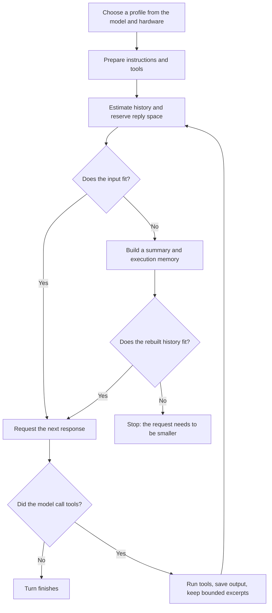

# Context shifting for local models

[Documentation](../README.md) / Guides / Context shifting

Local models often have small context windows and limited hardware. For `ollama-local` and `llamacpp`, Eirene adapts its instructions,
tools and budgets to the model and machine, then replaces old history with a compact handoff so that longer tasks can
continue. This is called dynamic context shifting.

It does not switch models or enlarge the context window. It makes room in the window you have. A model that cannot
call tools reliably will still struggle.

[Context and usage](context-and-usage.md) covers the general behavior for all providers; this page adds what is specific
to local models.

## How a request flows



## Profiles

Eirene reads your RAM, CPU threads and GPU information, and asks the server for the model's details, then picks a profile:

| Profile | Context allowance | Maximum reply tokens | Rounds per work batch |
| --- | ---: | ---: | ---: |
| Compact | 4,096 | 1,024 | 5 |
| Balanced | 8,192 | 4,096 | 12 |
| Full | 32,768 | 16,384 | 40 |

The first rule that matches decides:

1. **Compact** if RAM is under 12 GB, the CPU has at most two threads, the model has at most 4.5 billion parameters, or
   its size is unknown and no GPU memory was detected.
2. **Balanced** if the model has at most 10 billion parameters.
3. **Balanced** if GPU memory is under 8 GB or RAM is under 24 GB.
4. **Full** otherwise.

An NVIDIA GPU is assumed to have 8 GB, and Apple Silicon is assumed to have half of its RAM available. These rules are
conservative estimates, not benchmarks.

The usable window is the smaller of the profile's allowance and the context length the model advertises. An entry in
[`model_context_limits`](context-and-usage.md#set-context-limits) can lower it further but cannot raise it. Eirene passes
the result to Ollama as `num_ctx`.

llama.cpp differs because its memory is allocated when the server starts. Eirene therefore uses the server's whole context, even above the profile's allowance, and a small context also lowers the profile. See [How Eirene adapts](../providers/README.md#how-eirene-adapts).

## What each profile sends

Smaller profiles spend less of the window on overhead:

| Profile | Instructions | Tools |
| --- | --- | --- |
| Compact | Short operating instructions | Files, search, edits, commands, web and processes |
| Balanced | Short operating instructions | The compact set, plus images, project information, diagnostics and symbol navigation |
| Full | The complete instructions | The complete tool list |

All profiles keep enabled skills, plugin guidance and MCP instructions and tools. On compact and balanced profiles,
[subagents](subagents.md) are offered only when a plugin is enabled.

## How the budget is calculated

```text
hard_limit       = smaller of the usable window and any configured limit
reply_reserve    = maximum reply tokens + 256
input_budget     = smaller of (80% of hard_limit) and (hard_limit - reply_reserve)
                   and context_warning, if positive
history_budget   = input_budget - instructions and tools
```

For example, a compact profile with a 4,096-token window and 1,024 reply tokens has an input budget of 2,816 tokens. If
instructions and tools take about 900, around 1,900 remain for history. Estimates use about one token per four characters.

## The handoff

Compaction builds two records that complement each other:

- **The summary** is written by the model and covers earlier requests, decisions and progress. Long transcripts are
  summarized in chunks, with no tools and at most 512 output tokens per request.
- **Execution memory** is extracted by Eirene from recorded tool results, independently of the summary. Each entry
  names the tool, its target, a shortened result, whether it failed, and where the full output is saved.

The handoff tells the model plainly that starting a command does not prove it finished, and that unfinished work still
needs checking. The previous history is saved as an output, so nothing is lost from disk.

On local models, recent tool results are shortened to 800 characters. If the rebuilt history is still too large, older
messages are dropped; your latest request is always kept. If it still does not fit, compaction fails instead of sending
an oversized request.

## Limits on tool output

After each tool runs, Eirene works out how much space remains and divides it among the results. For local profiles, a result
is capped at 12,000 characters or half the profile's context tokens counted as characters, whichever is smaller. A longer
result keeps an excerpt and, where there is room, a pointer the model can use to read more pages of the saved output.

## When progress stalls

Eirene watches for a model going in circles:

- Repeated tool calls with unchanged outcomes prompt the model to try something different.
- If progress stalls, it is asked to reassess the unfinished objective. If that does not help, you can choose to continue,
  try another approach, or pause and switch models.
- A reply cut off by the token limit gets up to two continuation attempts. Tool calls left incomplete are marked as not run.

Work can carry on into another batch of rounds as long as recent tool results keep changing.

## Choosing settings

- `/usage` shows the estimated context in use.
- `/compact` summarizes on request.
- [`/think`](../providers/thinking.md) affects speed and resource use on models that support it.
- If tasks keep failing, try a model with reliable tool calling, or a machine with more memory.
