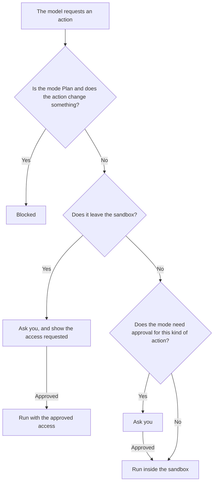
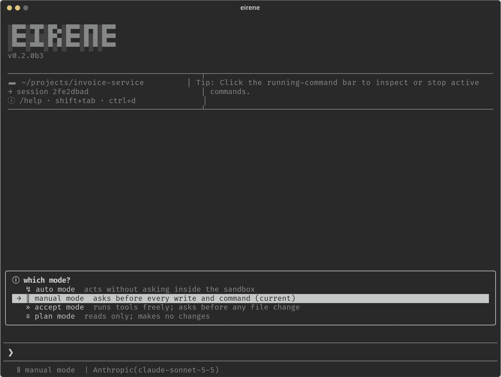
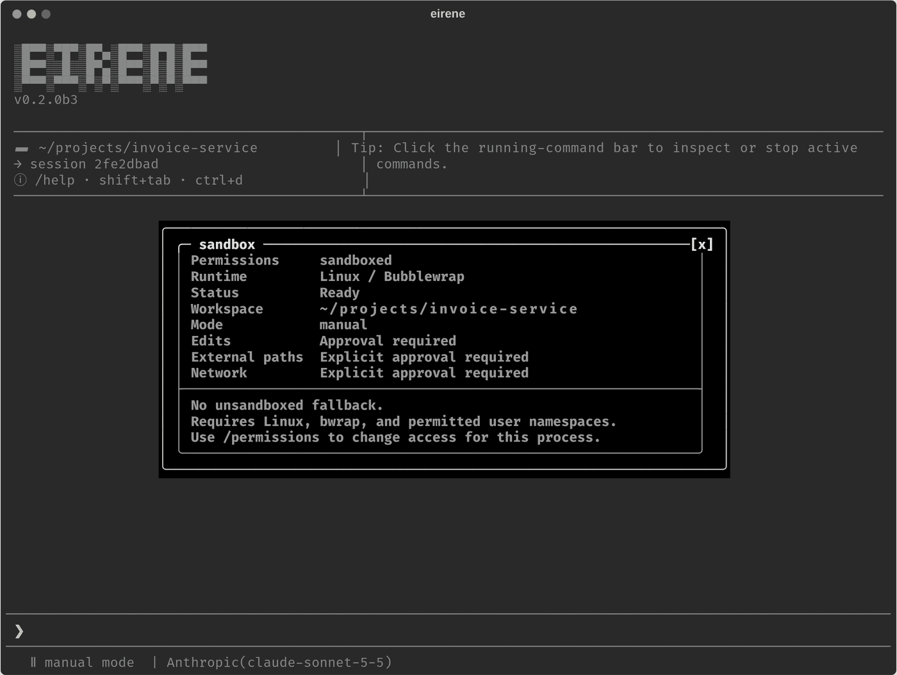

# Modes and permissions

[Documentation](../README.md) / Guides / Modes and permissions

Eirene works on the real files in your workspace, so it helps to know exactly what it may
do without asking. Two separate settings control this:

- **Mode** decides which actions need your approval.
- **Permissions** decide how far those actions can reach: inside the sandbox, or anywhere
  your user account can.



## Modes

Press Shift+Tab to cycle through the modes, run `/agents` for a menu, or name one directly:

```text
/agents manual
/agents accept
/agents auto
/agents plan
```



| Mode | Reading files | Changing files | Running commands |
| --- | --- | --- | --- |
| **Manual** | Harmless reads in the workspace run freely. | Asks. | Asks, except for recognized read-only commands. |
| **Accept** | Runs freely in the workspace. | Asks. | Runs, but asks for any command that can create, change, move or delete files. |
| **Auto** | Runs freely in the workspace. | Runs in the workspace. | Runs inside the sandbox. |
| **Plan** | Runs freely in the workspace. | Blocked. | Blocked. |

Manual is the default, and your choice is saved. A [headless run](../automation/headless.md)
uses Auto unless you pass `--mode`.

**In Accept mode**, the commands that ask include `rm`, `mv`, `sed -i`, `git checkout`,
`npm install` and anything with an output redirect. Commands Eirene cannot read clearly also
ask.

**In Plan mode**, Eirene can inspect files and run fixed read and search operations. It
cannot edit project files, run arbitrary commands, start plugin hooks or MCP servers, or gain
more access by asking. It can update the [session plan](plans.md), which is stored outside your
project.

A request to read a path outside the workspace can prompt in any mode. Web search never asks.

## The sandbox

Every Eirene process starts in `sandboxed` permissions. Run `/sandbox` to see the current state:



Inside the sandbox:

- The workspace is writable, according to the mode.
- Paths outside it are off limits until you approve them.
- Commands have no network access until you approve it.
- Commands run under your operating system's isolation:
  [Bubblewrap on Linux, Seatbelt on macOS and AppContainer on Windows](../platforms/platform-support.md).

If the isolation cannot start, Eirene reports the failure and refuses to run the command. It
never falls back to running without isolation. `/sandbox` only reports status and has no
options.

### Temporary host access

When a task needs to go outside the sandbox, such as a system-wide install, Eirene asks. The
prompt states the scope: **full host access for the current response**. Restrictions return as
soon as the response finishes, fails or is stopped, and any commands or services started under
the approval are stopped too.

Host access changes where tools can run. It does not change whether they need approval: Manual
mode keeps asking before each change and command.

## Full access

```text
/permissions full-access
```

This turns off Eirene's file containment, command isolation and network restrictions for the
current process. Use it when you want to work without the sandbox and accept the risk.

- Commands can do anything your account can do. This is not root or administrator access.
- Approvals still follow the mode: Manual keeps asking, Auto proceeds without asking.
- Plan mode stays read-only.
- The setting is never saved. Every new process, including a resumed session, starts sandboxed.

Finish or stop the current turn before changing it. To return:

```text
/permissions sandboxed
```

This stops the commands and MCP servers Eirene manages. It does not undo what they already did.

## How file and network rules are enforced

There is no single switch behind these rules; each type of tool enforces them separately:

| Tool type | Where the limits are applied |
| --- | --- |
| File tools | Eirene resolves each path, following symlinks, and checks that it stays inside the workspace. |
| Commands, hooks, MCP stdio servers | The operating system sandbox. |
| Browser and HTTP tools | Eirene runs them itself and requests network approval. |
| Codex and Claude Code connections | The external CLI runs its own tools. Eirene forwards approvals and requests the CLI's sandbox controls. |

## Plugins and MCP servers

Installing a plugin activates nothing. `/plugins trust NAME` turns on all of it, including its
hooks and MCP servers. Standalone MCP servers you add have their own switch in `/mcp`. See
[Plugins](../extending/plugins.md#trust-a-plugin) and [MCP servers](../extending/mcp.md).

Trust does not widen these rules: plugin tools still follow your mode and sandbox. A plugin's
requested model or allowed-tools list does not override them. An MCP server can declare
network access and extra paths for its own process, and Eirene shows these before enabling it.

## Related

- [Security policy](../../SECURITY.md)
- [Windows sandbox](../platforms/windows-sandbox.md)
- [Running commands](running-commands.md)
