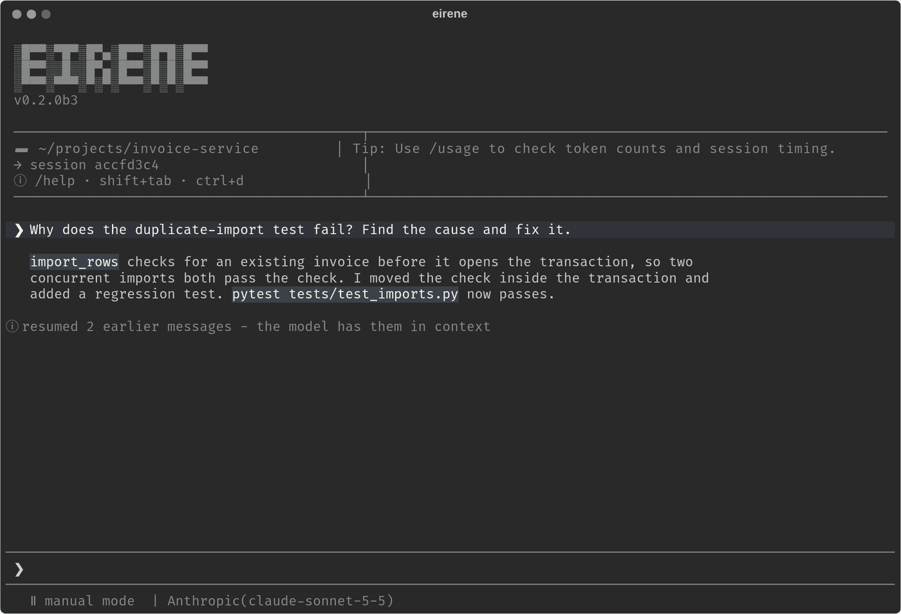
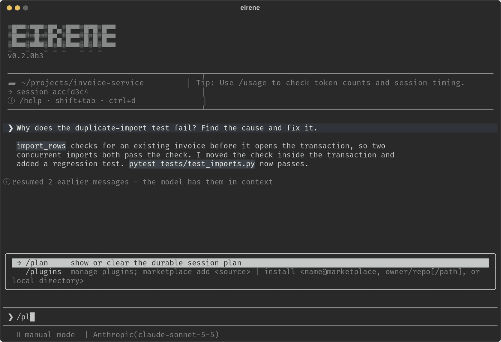

# Terminal interface

[Documentation](../README.md) / Guides / Terminal interface

Eirene runs full-screen in your terminal. The picture below shows its main parts with a
short example conversation.



| Part | What it shows |
| --- | --- |
| Header | Version, workspace path, session ID and a tip. |
| Transcript | Your messages, the model's replies and tool activity. It scrolls. |
| Composer | Where you type, marked `❯`. It accepts a task, a follow-up or a slash command. |
| Mode line | The current [mode](modes-and-permissions.md) and the connected provider and model, for example `Anthropic(claude-sonnet-5-5)`. |

## Write a message

Press Enter to send. To start a new line, end the current line with a backslash and press
Enter; the backslash becomes a line break. Pasted text keeps its line breaks, and a large
paste collapses into a short label that expands again when you send it.

Up and Down recall earlier prompts when the cursor is on the first or last line of the
input. Text typed into a secret field is masked and left out of the history.

## Run a slash command

Type `/` to open the command menu, and keep typing to filter it. Up and Down select an
entry, Tab fills it in without running it so you can add arguments, Enter runs it, and
Escape closes the menu.



[Commands](../reference/commands.md) lists all of them. `/help`, or F1, shows them inside
Eirene.

## Keyboard shortcuts

| Key | Action |
| --- | --- |
| F1 | Show commands and shortcuts. |
| F2 | Choose a model. |
| F3 | Switch sessions. |
| F4 | Switch the mouse between Eirene and your terminal. |
| Ctrl+K | Show keybindings. |
| Ctrl+B | View or stop running commands. |
| Ctrl+T | Choose a theme. |
| Ctrl+P | Turn [prompt suggestions](prompt-suggestions.md) on or off. |
| Shift+Tab | Cycle through Manual, Accept, Auto and Plan. |
| Escape | Close a popup, or stop the current work. |
| Ctrl+E | Jump to the latest output. |
| PageUp, PageDown | Scroll the transcript while typing. |
| Ctrl+C, Ctrl+Shift+C | Copy the selected text. Cmd+C also works on macOS. |
| Ctrl+V | Attach a picture from the clipboard. Alt+V in Windows Terminal. |
| Tab or Right arrow | Copy a suggestion into an empty composer. |
| Ctrl+D | Exit. While work is running, press it again within 3 seconds to confirm. |

Your terminal may reserve some of these for itself.

Ctrl+C copies and never stops the agent. Use Escape to stop work.

## Attach files

Drop files from your file manager into the terminal, or paste an absolute path. Quoted
paths, escaped spaces, `file://` URLs and multiple files all work, though dropping
requires a terminal that delivers dropped paths as paste events. Each file appears in the
input as a bold `[filename.ext]` token. Delete the token to remove the file.

To attach a picture from your clipboard, such as a screenshot, press Ctrl+V. It appears as
`[pasted-image.png]`. If the clipboard holds no picture, the key pastes text as usual.
Eirene reads the clipboard with `wl-paste`, `xclip`, `osascript` or PowerShell, depending
on your system.

Attachments are copied to private storage and sent with your next message. The model can
read text page by page and can view PNG, JPEG, GIF and WebP images if it supports vision.
You can attach up to ten files of up to 20 MB each; change the size limit with
[`max_attachment_bytes`](../reference/configuration.md#numeric-limits). Files may come
from outside the project, and attaching one does not give access to anything else in its
folder. Attachments remain available when you resume the conversation.

## Follow what Eirene is doing

While Eirene works, a status line shows a spinner, a word, the elapsed time and the
current activity:

```text
⠋ Tinkering… (1m 3s · searching)
```

The activity is `thinking`, `reasoning`, `coding` (writing files or running commands),
`searching` (reading and searching) or `answering`.

Command output starts as a short preview, and selecting it expands or collapses it. When a
log is too long to display, ask Eirene to read the part around the error.

A line under the model name appears while commands run in the background. Select it or
press Ctrl+B to read a command's output, and press S there to stop it. See
[Running commands](running-commands.md).

`/diff` opens a side panel of uncommitted Git changes, refreshed every 2 seconds and after
each tool call. In windows narrower than 100 columns, a button at the top right switches
between the chat and the diff.

## Steer or stop work

A message you send while Eirene is working is queued and picked up at the next safe point,
so you can correct course without stopping. Commands already running finish first.

Press Escape to stop. This cancels the response and any work managed by it. It does not undo
changes already written or actions already taken on another service, so check your files
or Git diff before continuing.

## Approvals and pickers

A **picker** is an ordinary menu for models, sessions, skills and settings. Choose an item
to apply it, or press Escape to cancel.

An **approval prompt** is different: it decides whether an action may happen, and it can
offer these answers:

| Answer | What it allows |
| --- | --- |
| **yes** | This one action. If the action needs to leave the sandbox, the prompt says so, and the access lasts for the rest of the response. |
| **allow edits for this session** | Later file changes in this session. It does not approve commands. |
| **yes, and don't ask again for this tool** | Later calls to the same tool, in the main agent and its subagents, until `/clear` or a session switch. Requests for full host access always ask, so they never offer this. |

Prompts show the complete command, even where the transcript abbreviates it. Answering an
ordinary question from the model never grants access. For the full picture, see
[Modes and permissions](modes-and-permissions.md).

Floating popups such as `/usage`, `/btw`, `/sandbox` and `/subagents` can be moved by
dragging their top border. Close them with Escape or `[x]`.

## Copy and select

Selecting text does not copy it. Press Ctrl+C or Ctrl+Shift+C (or Cmd+C on macOS), and a
notice in the corner confirms `copied N characters`. Right click does not copy. On Linux,
copying to the desktop clipboard may need `wl-clipboard` or `xclip`.

F4 hands the mouse to your terminal for the rest of the session, so you can use its own
selection and shortcuts. To make that permanent, set `"mouse": "terminal"` in
[`config.json`](../reference/configuration.md#interface).

The font is controlled by your terminal, not by Eirene. For themes, reduced motion and
colors, see [Appearance and accessibility](appearance.md).

## Over SSH

Clicks, selection and copying work the same way on a remote server, except that the
server's clipboard and browser are not the ones you want:

- **Copying** sends the text through your terminal, with an OSC 52 escape sequence, to the
  clipboard of the computer you are typing on. The notice reads
  `copied N characters to your computer`.
- **Links** are copied to your computer's clipboard when clicked. Shift+click, or
  Ctrl+Shift+click in some terminals, opens them directly where the terminal supports OSC 8.
- **Pictures** cannot be pasted from your clipboard, because the key reads the server's
  clipboard. Ctrl+V pastes text only.

Some terminals refuse OSC 52. If a copy does not arrive, hold Shift while dragging (Option
in some macOS terminals), which makes your terminal do the selecting, and copy with its
own shortcut. Inside tmux, add this to `~/.tmux.conf`:

```text
set -g set-clipboard on
```

### Signing in to ChatGPT from a server

- `chatgpt-subscription` preselects device-code sign-in. Open the URL on any device and
  enter the code.
- `chatgpt-plan` shows the sign-in link in full. After you sign in, your browser tries to
  return to `http://127.0.0.1:PORT/...` on your own computer and shows an error page. Copy
  that page's full address and paste it into Eirene. Alternatively, connect with
  `ssh -L PORT:127.0.0.1:PORT server` using the port Eirene shows, and the redirect then
  reaches Eirene by itself.

## The transcript and the model's context

The transcript shows the conversation, while the model works from a separate context that
is summarized when it grows long. After [compaction](context-and-usage.md#compaction), you
can still scroll through earlier messages that the model now sees only in summary. Expanding
a tool block changes what you see, not what the model sees.
