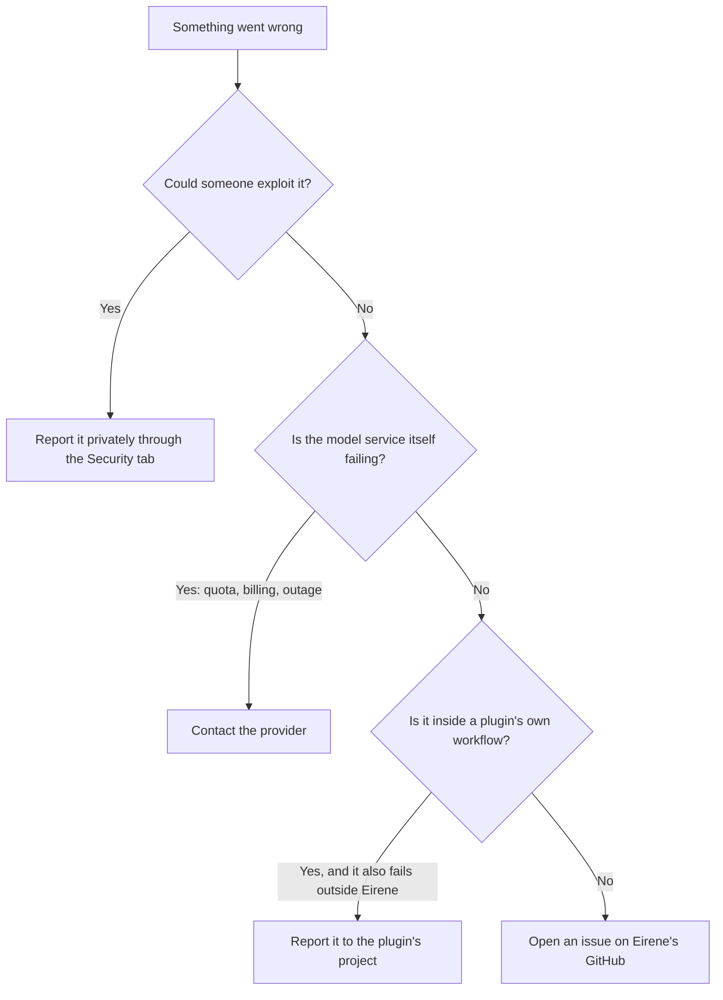

# Reporting bugs and crashes

[Documentation](../README.md) / Help / Reporting bugs and crashes

If Eirene crashes, shows an error it should not, or does something this documentation
says it will not, please open an issue on GitHub. A good report is usually a few
commands' worth of output and a short description, and this page shows how to gather
them.

**[Open a new issue](https://github.com/0v3rf3ar/Eirene/issues/new)** ·
[Search existing issues](https://github.com/0v3rf3ar/Eirene/issues?q=is%3Aissue)

## Where does it belong?



**Security problems** must not go in a public issue. Unapproved file access, command
execution and credential exposure all count. Use
[Report a vulnerability](https://github.com/0v3rf3ar/Eirene/security/advisories/new)
so the details stay private until a fix is available. The
[security policy](../../SECURITY.md) explains what to include.

**Plugins** have their own authors, listed in the
[catalog](../extending/plugin-catalog.md#credits). If a plugin fails to install, load
or run in Eirene, report that here. If its advice or workflow is the problem, report
it to the plugin's project.

## Step 1: Gather the facts

Run these from the terminal where the problem happens:

```sh
eirene --version
eirene --doctor
```

`--doctor` reads your setup without contacting any service. It prints your platform,
configuration version, active provider name and data directory, and it lists your five
most recent crash reports. It never prints API keys.

Also note:

- your terminal and, if used, tmux or SSH;
- your provider and model, and your [mode](../guides/modes-and-permissions.md);
- what you did, what you expected, and what happened instead, including the exact
  error text;
- whether it happens every time.

## Step 2: Find the crash report

When something unexpected fails, Eirene writes a crash report and, if it can, keeps
running. You will see one of these:

- `Something went wrong (...). Eirene recovered; your session is intact.`
- A failed slash command followed by `(details: PATH)`.
- `crash report: PATH` printed in your terminal after Eirene exits.

Reports are stored under `logs/crashes/` in your
[data directory](../reference/data-directory.md), and the newest 20 are kept. To see the
latest one:

```sh
ls -t ~/.local/share/eirene/logs/crashes/* | head -n 1
```

```powershell
Get-ChildItem "$HOME\.local\share\eirene\logs\crashes" | Sort-Object LastWriteTime -Descending | Select-Object -First 1
```

If you set `EIRENE_HOME`, look there instead.

## Step 3: Reproduce with debug logging

If you can make the problem happen again, this step often makes the report much more
useful. Start Eirene with `--debug`:

```sh
eirene --debug
```

This logs at debug level and names the failing handler in each warning, such as
`Prompt#prompt.on_paste`. After reproducing the problem, take the end of the runtime
log:

```sh
tail -n 100 ~/.local/share/eirene/logs/eirene.jsonl
```

```powershell
Get-Content "$HOME\.local\share\eirene\logs\eirene.jsonl" -Tail 100
```

For a problem in a [headless run](../automation/headless.md), add `--json` and include
the `status`, `error_kind`, `errors` and `exit_code` fields.

## Step 4: Check what you are sharing

GitHub issues are public. Read everything before you post it.

| File or output | What it contains | What to check |
| --- | --- | --- |
| Crash report | Version, platform, terminal settings, the executable's path, and a traceback. Local variables are left out, so keys held in memory stay out of it. | Your username in paths, and any private text in the error message. |
| `eirene --doctor` | Platform, data paths, provider names, and counts. No keys. | Your username in paths. |
| `logs/eirene.jsonl` | Timed events with session IDs, provider and model names, and tool names, plus tracebacks when something failed. | The same as a crash report. |
| [Session export](../guides/sessions.md#export-a-conversation) | The conversation itself, including tool output. | Everything. Share one only if it is needed, and only after removing private content. |
| `config.json` | Your settings, **including API keys** under the default file credential store. | Do not attach this file. Copy only the fields that matter. |

Remove API keys and tokens, private URLs and hostnames, customer data, and proprietary
code. If a key does end up in a public post, revoke it with the provider, because
editing the post does not remove it from the issue's history.

## Step 5: Open the issue

[Open a new issue](https://github.com/0v3rf3ar/Eirene/issues/new), give it a title that
names the symptom, such as "Crash when pasting an image over SSH", and paste this
template:

````markdown
## What happened
What you did, what you expected, and what happened instead.

## How to reproduce
1.
2.
3.

Happens: every time / sometimes / once

## Environment
- Eirene version:
- Operating system:
- Terminal (and tmux or SSH, if used):
- Provider and model:
- Mode:

## Diagnostics
<details>
<summary>eirene --doctor</summary>

```text
paste here
```
</details>

<details>
<summary>Crash report</summary>

```text
paste here, or attach the .txt file
```
</details>
````

Please keep it to one problem per issue. You can attach a crash report by dragging the
`.txt` file into the comment box, and screenshots are especially helpful for display
problems.

## Before you post

- Try the [latest release](../getting-started/updating.md), in case it is already fixed.
- Check [Troubleshooting](troubleshooting.md) for a known cause.
- For plugin problems, include the output of `/plugins inspect NAME` and
  `/plugins doctor NAME`.
