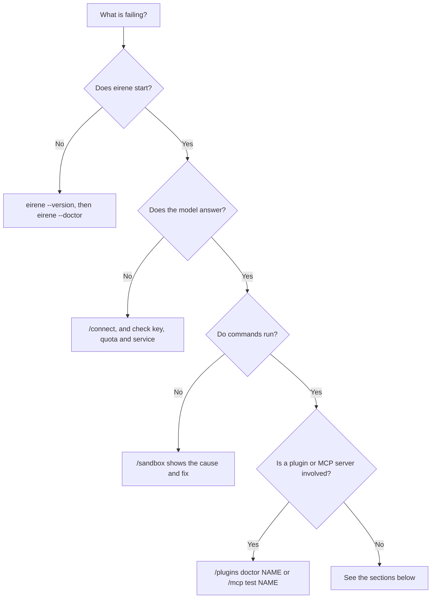

# Troubleshooting

[Documentation](../README.md) / Help / Troubleshooting

Find your symptom below. If it is not listed, or the suggested fix does not help,
[report it](reporting-issues.md).



## Run the diagnostics

```sh
eirene --version
eirene --doctor
eirene --doctor --json
```

The doctor is read-only. It checks that the data directory is writable, the
configuration version, whether the active provider is known, which credential stores
and sandbox tools are available, and which crash reports exist. It does not contact the
model service or run plugin code, so `Result: ready` means your configuration is sound
and says nothing about whether a key works.

## Installation and startup

| Symptom | Cause and fix |
| --- | --- |
| `eirene` is not found | `PATH` has not been refreshed. Open a new terminal, or run the executable by its [full path](../getting-started/installation.md#check-the-installation). |
| The interface will not start from a pipe or script | The interface needs a real terminal. Use `-p` for a [headless run](../automation/headless.md). |
| The workspace is rejected | `-C` must name an existing directory. Quote paths that contain spaces, and check permissions. |
| Settings or sessions seem to have disappeared | Check `EIRENE_HOME`. Each data directory has its own settings and history. See [below](#settings-reset-to-defaults). |
| `eirene could not start` | Follow the printed crash report path and [report it](reporting-issues.md). |

## Providers and models

| Symptom | Cause and fix |
| --- | --- |
| No provider is selected | Run `/connect` and choose a model. |
| A key is rejected | Replace it with `/connect PROVIDER!`, then check the account's access and quota. |
| The model answers but cannot act | The connection has no tools. Perplexity is text-only, and some local or custom models lack tool calling. Choose another [connection](../providers/README.md). |
| A listed model fails | A model appearing in a list does not mean your account can use it. Choose another. |
| A local model is unavailable | Check that the Ollama service is running and the model is downloaded, then reconnect. |
| `cannot reach localhost:...` with llama.cpp | `llama-server` is not running, or uses another port. Start it, and use the address it prints with `/connect llamacpp!`. See [llama.cpp](../providers/README.md#llamacpp). |
| llama.cpp is `still loading its model` | Wait for the server to finish loading, then try again. |
| A llama.cpp request is `larger than llama-server's context` | Run `/compact`, or restart the server with a larger `-c`. |
| llama.cpp replies come back cut off | The context may be too small for the reply, or thinking may be using it up. Try a larger `-c` or [`/think nothink`](../providers/thinking.md#local-models). |
| ChatGPT sign-in over SSH ends on a `127.0.0.1` error page | Paste that page's full address into Eirene, or use `ssh -L` with the port shown. See [Over SSH](../guides/terminal-interface.md#over-ssh). |

### A response is slow or keeps reconnecting

Temporary API failures are retried automatically, up to 12 attempts by default, while
nothing has been delivered yet. The wait can grow to a minute, or longer if the service
asks for it. The status line shows what is happening, and Escape cancels the wait.

Authentication and quota errors stop immediately. A response that was partly delivered
is not replayed automatically, because actions may already have run: check your files
and any running commands before asking Eirene to try again.

For Gemini, an exhausted daily quota stops retries and shows a diagnostic. Check your
limits in [Google AI Studio](https://aistudio.google.com/usage?tab=rate-limit), wait for
the reset, or `/connect` to another provider.

## Commands and the sandbox

| Symptom | Cause and fix |
| --- | --- |
| Commands cannot start on Linux | Run `/sandbox`. It starts a test sandbox and names the cause and fix: a missing `bwrap`, blocked user namespaces, or a container without nesting. See [Linux](../platforms/platform-support.md#linux). |
| Commands cannot start on macOS | `sandbox-exec` is missing or failed. `/sandbox` shows the failure. |
| A Windows command fails with an access error | The program may not be reachable from the sandbox. See [What sandboxed commands can reach](../platforms/windows-sandbox.md#what-sandboxed-commands-can-reach). |
| A tool or file in your home directory is not found | Sandboxed commands get a private home. See [Sandbox environment](../platforms/platform-support.md#what-sandboxed-commands-see). |
| A server stops after a response | It was started under a temporary host-access approval, which ended. See [Running commands](../guides/running-commands.md#servers-and-watchers). |
| A command seems stuck | Press Ctrl+B to read its output. A quiet command may still be working. |

## Plugins, skills and MCP

Start with these commands:

```text
/plugins
/plugins inspect NAME
/plugins doctor NAME
/skills
/mcp test NAME
```

| Symptom | Cause and fix |
| --- | --- |
| A plugin's commands are missing | The plugin needs trust: `/plugins trust NAME`. This is also needed after `/plugins update` changes it, or after `/plugins refresh`. |
| A command has the wrong name | Two commands share a name. Use the full form, `/plugin:command`. |
| A skill does not appear as a command | The skill may declare itself as not user-invocable, or may be off in `/skills`. |
| Hooks or MCP servers do not run | They do not start in Plan mode, and start with your next message after you trust the plugin. |
| A server fails to start | `node`, `npx`, `uvx`, `git` or another launcher must be installed and on `PATH`. First startup can also need network access for downloads. |
| A server connects but its tools fail | The browser, language server or account behind it may still need setup. Check that plugin's [guide](../extending/plugin-catalog.md). |
| A remote server needs signing in again | Run `/mcp login NAME`. |

## Interface

| Symptom | Cause and fix |
| --- | --- |
| Copying does not reach your clipboard | On Linux, install `wl-clipboard` or `xclip`. Terminal clipboard settings also matter. |
| Copying over SSH does not reach your computer | Your terminal may refuse OSC 52. Hold Shift while dragging to use its own selection, and in tmux add `set -g set-clipboard on`. See [Over SSH](../guides/terminal-interface.md#over-ssh). |
| A key does nothing | Your terminal may use that key itself. `/keybindings` lists Eirene's keys. |
| Clicks or selection misbehave | Press F4 to hand the mouse to your terminal, or set `"mouse": "terminal"`. |
| The companion does not appear | It is off by default and needs a terminal with Kitty graphics or Sixel. See [Appearance](../guides/appearance.md#companion). |
| A notification does not appear | Run `/notification test`, then check your desktop's settings. See [Notifications](../guides/notifications.md). |

## Settings reset to defaults

First confirm which data directory is in use: `eirene --doctor` prints it under `Data`.

If `config.json` contains invalid JSON, or something other than a JSON object at the
top level, Eirene copies it to `config.json.bak` and starts with defaults. The next save
replaces the original, so **copy both files somewhere safe right away**, fix the syntax,
and put the repaired file back while Eirene is closed.

Some values are corrected deliberately when Eirene loads the file. Full access is never
restored, numbers are limited to their allowed range, and objects of the wrong type
become empty. The [configuration reference](../reference/configuration.md#how-the-file-is-loaded)
lists these rules.

Avoid deleting the whole data directory to fix a single problem. Doing that also removes
your sessions, plugins and routines.

## Error messages inside a running session

When something unexpected fails during a paste, click or background task, Eirene shows a
warning, keeps your session, and writes a crash report. If errors repeat several times
within a few seconds, Eirene treats this as a crash loop, exits, and prints the report's
path. In either case, please [send us the report](reporting-issues.md).
