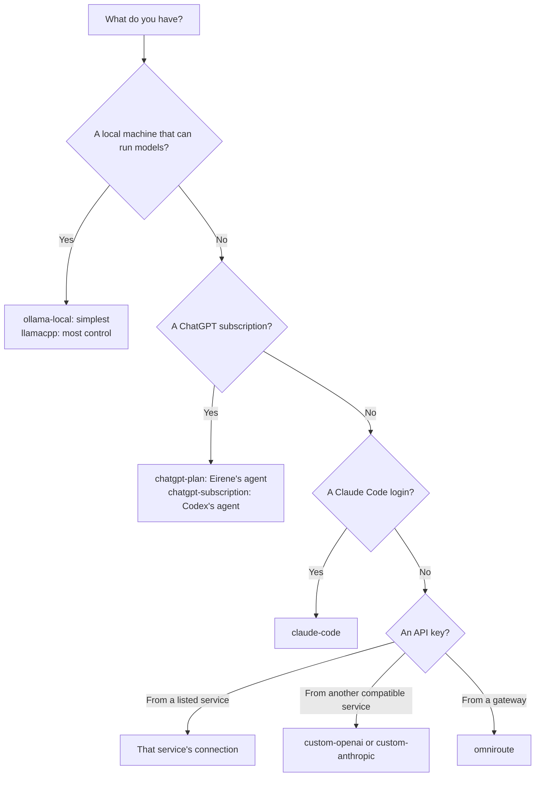
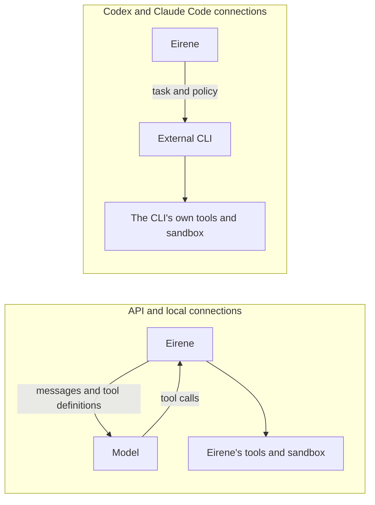

# Providers and models

[Documentation](../README.md) / Providers and models

A provider connects Eirene to a model. You can use a pay-per-use API, a model running on your own machine, a subscription you already have, or
any service with a compatible API.

## Choose a connection



| Name for `/connect` | Service | What you need |
| --- | --- | --- |
| `anthropic` | Anthropic API | Anthropic API key. |
| `chatgpt` | OpenAI API | OpenAI API key with access to the model. |
| `gemini` | Google AI Studio | Google AI Studio API key. |
| `groq` | Groq API | Groq API key. |
| `deepseek` | DeepSeek API | DeepSeek API key. |
| `kimi` | Moonshot API | Moonshot API key. |
| `perplexity` | Perplexity search models | Perplexity API key. Text responses only. |
| `ollama` | Ollama | Opens a choice of Cloud (API key) or Local. |
| `ollama-cloud` | Ollama Cloud | Ollama API key. |
| `ollama-local` | Ollama on your machine | A running Ollama service and a downloaded model. |
| `llamacpp` | [llama.cpp](#llamacpp) on your machine or another | A running `llama-server`. |
| `chatgpt-plan` | ChatGPT subscription | Browser sign-in, and a plan eligible for this integration. Eirene runs the tools. |
| `chatgpt-subscription` | Codex CLI | `codex` on `PATH`, and a ChatGPT login. Codex runs the tools. |
| `claude-code` | Claude Code CLI | `claude` on `PATH`, already signed in. Claude Code runs the tools. |
| `custom-openai` | Any OpenAI-compatible endpoint | A base URL and key. |
| `custom-anthropic` | Any Anthropic-compatible endpoint | A base URL and key. |
| `omniroute` | [OmniRoute gateway](omniroute.md) | The Eirene adapter and a running gateway. |

Shorter aliases also work: `openai` or `gpt` for `chatgpt`, `claude` for `anthropic`, `codex` for `chatgpt-subscription`, `claude-cli` for
`claude-code`, `google` for `gemini`, `moonshot` for `kimi`, `pplx` for `perplexity`, `llama.cpp` or `llama` for `llamacpp`, and `custom` for `custom-openai`.

## Connect and switch

```text
/connect
/connect anthropic
/model
/model MODEL_NAME
```

`/connect` opens the provider list, and adding a name goes straight to that provider. Eirene checks API connections and offers a model picker. If
a service cannot list its models, Eirene shows a bundled list instead. Appearing in a list does not guarantee your account can use a model.

Enter keys only in the hidden prompt, never in the chat. Saved keys are reused when you switch. To replace a saved key or URL, add `!`:

```text
/connect custom-openai!
```

F2 also opens the model picker. The mode line shows the active connection as `provider(model)`, for example `Google(gemini-2.5-flash)`.

## Who runs the tools

The main difference between connections is who runs the agent loop.



**API and local connections** use Eirene's own tools, approvals, sandbox, compaction and session handling. The model must support tool calling to
touch files or run commands. A text-only model can only answer questions, and vision needs a model and endpoint that support images. Sharing a
protocol does not guarantee tools, images or every parameter.

**CLI connections** use the external program's tools, context handling and subscription limits. Eirene forwards approvals, plugin guidance and enabled
MCP servers. What you see depends on what the installed CLI exposes, and Eirene's limits do not all carry over. For example, a restricted
[`--tools`](../automation/headless.md#tools-and-access) list cannot be enforced, so that run fails with an error instead.

## Local models with Ollama

Start Ollama and download a model using your usual Ollama setup, then:

```text
/connect ollama-local
```

Eirene connects to `http://localhost:11434` by default, with no API key, and lists the models available from that service. Requests to either
Ollama connection have a timeout of at least 600 seconds.

A local model's memory use, context size and tool reliability decide what it can do. Eirene adapts to smaller models, as described in
[Context shifting](../guides/context-shifting.md). [`/think`](thinking.md) controls its thinking option.

## llama.cpp

[llama.cpp](https://github.com/ggml-org/llama.cpp) runs GGUF model files directly and exposes more tuning than Ollama. The main difference to keep in mind is that **you start the server yourself, and the model and context size are chosen at that point**, not from inside Eirene.

| | Ollama | llama.cpp |
| --- | --- | --- |
| Who runs the service | A background service | You start `llama-server` |
| How you get models | `ollama pull` | A `.gguf` file, or `-hf` to download one |
| Switching models | `/model` | Restart the server, or use [router mode](#several-models) |
| Context size | Eirene requests one for each conversation | Fixed by the server's `-c` |
| A request that is too large | Silently truncated | An error |

### 1. Start the server

Install llama.cpp using [its instructions](https://github.com/ggml-org/llama.cpp#quick-start), then start it in its own terminal:

```sh
llama-server -m /path/to/model.gguf -c 32768 --alias my-model
```

Or let it download a model from Hugging Face:

```sh
llama-server -hf ggml-org/gemma-3-4b-it-GGUF:Q4_K_M -c 32768
```

| Option | Purpose |
| --- | --- |
| `-m FILE`, `-hf REPO:QUANT` | The model to serve. |
| `-c N` | The context size. Without it, the server uses the size stored in the model, which can need a lot of memory. |
| `--alias NAME` | A short name for Eirene's mode line. Without it, Eirene shows the file name. |
| `-ngl N` | Layers to place on the GPU. The default is `auto`. |
| `-np N` | Parallel slots. Subagents can run at the same time when there are several, and they queue with `-np 1`. |
| `--mmproj FILE` | The vision projector, for models that read images. `-hf` finds it automatically. |
| `--api-key KEY` | Require a key, which is worth doing if the server is reachable from other machines. |

Leave the terminal open: Eirene does not start or stop this server.

### 2. Connect

```text
/connect llamacpp
```

Enter the address the server printed, or press Enter for the default, `http://localhost:9931/v1`. Older llama.cpp versions use port `8080`, so check the server's output. Press Enter again at the key prompt unless you set `--api-key`. You can also supply the key with `EIRENE_LLAMACPP_API_KEY`.

Eirene then reports what it found, for example `1 model, 32,768-token context`.

### How Eirene adapts

Eirene reads the context size from the running server and budgets for it. The size also caps which [profile](../guides/context-shifting.md#profiles) it uses, so a small window gets shorter instructions and fewer tools:

| Server context | Largest profile |
| --- | --- |
| Under 8,192 tokens | Compact |
| 8,192 to 32,767 tokens | Balanced |
| 32,768 tokens or more | Full |

On your own machine, your hardware and the model's size can lower the profile further. A server on another machine is judged by its context alone. It is rechecked at each turn, so restarting the server with a different `-c` is picked up by itself. To budget for less than the server has, set [`model_context_limits`](../guides/context-and-usage.md#set-context-limits).

### Tools, thinking and images

- **Tools** rely on the server's Jinja chat templates, which are on by default. Tool calling works best with a model and template built for it. llama.cpp's [function calling guide](https://github.com/ggml-org/llama.cpp/blob/master/docs/function-calling.md) lists the supported formats.
- **Thinking** can be turned off with [`/think`](thinking.md#local-models). A thinking model can spend a small reply budget before it writes anything, so try this if replies come back cut off.
- **Images** work if the server was started with a vision model and its projector. Otherwise Eirene says so before sending the request.

### Several models

Started with no model, `llama-server` runs in router mode: it lists the models it knows about and loads each on demand, so `/model` can switch between them. Add `--models-dir FOLDER` to serve a folder of GGUF files. See [llama.cpp's guide](https://github.com/ggml-org/llama.cpp/blob/master/tools/server/README.md#using-multiple-models). Until a model has loaded, Eirene budgets from your hardware's profile.

With a single-model server, the server always answers with the model it loaded. If you restart it with a different model, run `/model` to update the name in the mode line.

## Custom endpoints

```text
/connect custom-openai
```

Enter the base URL, ending in `/v1`, and the key your service expects. Use `custom-anthropic` for an Anthropic-compatible service. Your service must
actually implement the requests and behavior Eirene sends. If it cannot list models, connect anyway and run `/model MODEL_NAME` with a name it accepts.

## ChatGPT subscription

There are two ways to use a ChatGPT subscription:

| | `chatgpt-plan` | `chatgpt-subscription` |
| --- | --- | --- |
| Agent loop | Eirene | Codex |
| Requires Codex CLI | No | Yes |
| Tools, approvals and sandbox | Eirene's | Codex's |

### `chatgpt-plan`

```text
/connect chatgpt-plan
```

Eirene opens OpenAI's sign-in page and also shows a **Sign in to ChatGPT** link. Use a browser on the same computer, or see
[Over SSH](../guides/terminal-interface.md#signing-in-to-chatgpt-from-a-server). Choose **Continue with Google** if that is how you use ChatGPT, approve
access, return to the terminal and select a model. Eirene never asks for your password.

Next, choose a [reasoning level](thinking.md#deepseek-and-chatgpt-plan).

Run `/connect chatgpt-plan` again to choose a saved account, add one, reauthorize or sign out. Signing out clears the tokens and attempts to revoke them
remotely.

Good to know:

- Your subscription's limits apply, and Eirene never falls back to API billing. You can see usage and manage access in
  [ChatGPT settings](https://chatgpt.com/settings/usage). OpenAI documents the
  [integration](https://developers.openai.com/siwc/token-sharing-open-source) and its
  [preview limitations](https://developers.openai.com/siwc/token-sharing-open-source/preview-limitations).
- This route does not accept an output limit, so `max_tokens` has no effect on it.
- Credentials are kept in `chatgpt/auth.json` in the [data directory](../reference/data-directory.md), not in `config.json`, and renew automatically.
- Requests of 1 KiB or more are compressed when that makes them smaller. The server decompresses them, so the model sees the same content.

### `chatgpt-subscription`

```text
/connect codex
```

Eirene uses an existing Codex login, or offers browser and device-code sign-in with a link and any code to enter.

## Claude Code

Sign in with the `claude` CLI first, then:

```text
/connect claude-code
```

Eirene checks the CLI and offers its models. On native Windows, each turn needs your approval, because Claude Code runs there without kernel isolation.
See [Platform support](../platforms/platform-support.md#windows).

## DeepSeek

`/connect deepseek` uses the Chat Completions API, with Eirene running all tools locally. Eirene reads each model's context size, output limit, image
support and thinking levels from the live model list. If that list is unavailable, it falls back to `deepseek-flash` and `deepseek-v4-pro`, with a
1,048,576-token context and up to 393,216 output tokens.

- **Thinking:** choose a level per model; see [Thinking and reasoning](thinking.md#deepseek-and-chatgpt-plan).
- **Images:** `deepseek-flash` accepts JPEG, PNG, GIF and WebP. `deepseek-v4-pro` is text-only, so switching to it with images in the history gives a
  diagnostic.
- **Usage:** `/usage` counts the API's totals, which already include cached input and reasoning. Configured cost estimates can differ from your bill,
  since DeepSeek's prices vary with caching and time.
- **Errors:** request, authentication and balance errors stop immediately. Rate limits and server errors are retried, unless text has already appeared.
- **Not used:** JSON mode, strict tools, prefix completion, FIM, the Files API, and DeepSeek's own search. To use the Anthropic-compatible route, connect
  with `custom-anthropic`.

## Credentials

By default, keys are saved in `config.json`, which has owner-only permissions on Linux and macOS. You can use your system's credential store instead, or supply a key through an
environment variable such as `EIRENE_ANTHROPIC_API_KEY`. See [Credentials](../reference/configuration.md#credentials). CLI connections keep their logins
with the CLI.

## How connections behave

- Agents using the same provider, endpoint and key share a limit of four concurrent requests and a rate-limit cooldown within one Eirene process.
  Separate processes do not coordinate.
- Retries honor `Retry-After` and are staggered after a cooldown.
- Before each request, Eirene checks that tool calls and results are paired correctly, and for Gemini and Anthropic that required signatures are present.
  A session that already lost this data cannot be repaired, so start a new conversation if the error persists after upgrading.
- On the `anthropic` connection, Eirene turns on prompt caching, so repeated input within a session costs less. It does not send this to `custom-anthropic` endpoints.
- Switching providers keeps your conversation, but the tools and limits may change.

A rejected key, used-up quota or unsupported endpoint must be resolved with the provider. See
[Troubleshooting](../help/troubleshooting.md#providers-and-models).

## Related

- [Thinking and reasoning](thinking.md)
- [Fast mode](fast-mode.md)
- [OmniRoute](omniroute.md)
- [Context and usage](../guides/context-and-usage.md)
