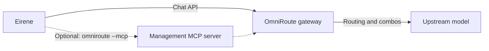

# OmniRoute

[Documentation](../README.md) / [Providers](README.md) / OmniRoute

[OmniRoute](https://github.com/diegosouzapw/OmniRoute) is a separate gateway that routes chat requests to the providers and model combinations you configure in it. Eirene has
an adapter for it with two independent parts:

| Part | What it does | Needs |
| --- | --- | --- |
| Chat connection | Uses the gateway as your model provider. | A running gateway. |
| Management tools | Lets the model inspect and configure the gateway through MCP. | The `omniroute` command on `PATH`, plus trust. |



Eirene does not download or start the gateway. Install and run it by following its own instructions, and configure providers in its dashboard. A Docker installation does not put
the `omniroute` command on your `PATH`.

## Connect chat

```text
/plugins install omniroute
/connect omniroute
```

Accept `http://localhost:20128/v1` or enter your gateway's URL ending in `/v1`, then enter its API key. Leave the key empty only if the gateway allows unauthenticated requests.
`EIRENE_OMNIROUTE_API_KEY` overrides the saved key.

Select a provider model, a combo, `auto/coding` or `auto`, depending on your gateway. Use `/model` to change it, and `/connect omniroute!` to replace the saved URL and key.

Routing, fallback, caching and compression are all gateway settings. Eirene uses its Chat Completions API for streaming, reasoning, tool calls, images and usage, so what works
depends on the routed model. Audio, image generation, embeddings and other gateway features are used through its own dashboard or API.

## Turn on management

```text
/plugins inspect omniroute
/plugins doctor omniroute
/plugins trust omniroute
```

Once trusted, Eirene launches `omniroute --mcp` on your next normal turn. Plan mode does not start it. Codex and Claude Code receive its definition through their own configuration.

You can use it even while another provider supplies the conversation model. `/omniroute` is the management command; connecting to chat is `/connect omniroute`.

```text
/omniroute Check gateway health and remaining provider quotas.
/omniroute List my combos and explain their routing strategies without changing them.
/omniroute Show usage and costs by provider, using the tools available in this gateway version.
```

The available tools depend on your gateway version. Say clearly whether you want inspection or changes.

### URL and key

The management tools use your saved OmniRoute URL, without `/v1`, and your saved key. They also need the right key scopes and, where the gateway requires it, Management Access
enabled in its dashboard. A key that works for chat is not necessarily allowed to manage.

To use a separate management URL or key, set `OMNIROUTE_BASE_URL` or `OMNIROUTE_API_KEY` under `mcpServers.gateway.env` in the installed `plugin.json`, then run
`/plugins refresh omniroute` and trust it again.

### Gateway data directory

Some management tools read the gateway's SQLite database directly, so the MCP process must use the running gateway's real data directory, including its encryption key. Eirene uses
`EIRENE_OMNIROUTE_DATA_DIR` if set. Otherwise it picks an existing `~/.omniroute`, then the platform's configuration default, with `~/.omniroute` as the fallback.

For a custom location, start the gateway first so the directory exists, and set the variable before launching Eirene and installing the adapter. If it is already installed, edit both
`DATA_DIR` and `write_paths` in the server declaration, then run `/plugins refresh omniroute` and trust it again.

Full management of a remote gateway requires the MCP process to run on that host. Changing the URL does not give it access to the remote database. Back up that database and its
encryption key yourself: they are not in Eirene's data directory.

## Access and turning it off

Enabling management grants the server network access and write access to the gateway's data directory. Eirene shows these grants in `/mcp`.

- Turn off management only: toggle the server off in `/mcp`. Its key is `omniroute__gateway`.
- Turn off the bundle: `/plugins disable omniroute`.
- Turn off all of it: `/plugins untrust omniroute`.

A gateway you started separately keeps running regardless.
